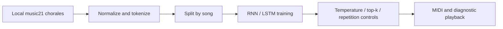

# Music Sequence Lab

**A practical study of sequence representation, recurrent models and repetition.**

An RNN/LSTM music-generation experiment that turns Bach chorales into symbolic
tokens, trains next-token predictors and explores controls for repetitive output.



## What to inspect

- Note/chord/rest representation and per-song sequence construction.
- RNN versus LSTM prediction and training/evaluation loops.
- Temperature, top-k and repetition-aware token sampling.
- Piano-roll inspection and MIDI reconstruction.
- CPU-oriented settings used to stabilize the original notebook.

## Run

```bash
python -m venv .venv
source .venv/bin/activate
pip install -r requirements-sampling.txt
python examples/sample_tokens.py
# For the full notebook:
pip install -r requirements.txt
jupyter lab
```

Open `notebooks/bach_sequence_models.ipynb`. It creates a local MIDI dataset from
the installed music21 corpus. Full model training is optional and substantially
heavier than the token-sampling example.

## Scope and attribution

This is an educational, coursework-derived experiment inspired by the
[MIT Introduction to Deep Learning music-generation lab](https://github.com/MITDeepLearning/introtodeeplearning/tree/master/lab1).
It preserves that attribution. No claim of a novel music-generation architecture,
professional audio quality or independent corpus ownership is made. No recordings,
third-party MIDI corpus or trained weights are redistributed.

See [VALIDATION.md](VALIDATION.md) for which checks were actually run and
[PROVENANCE.md](PROVENANCE.md) for source context.
